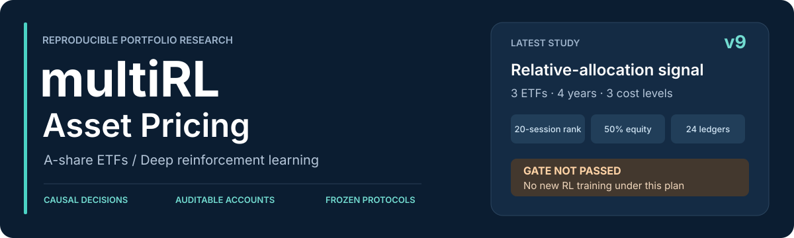
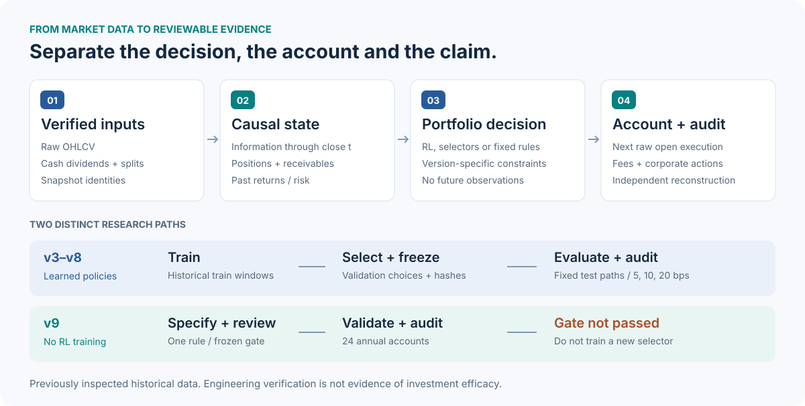
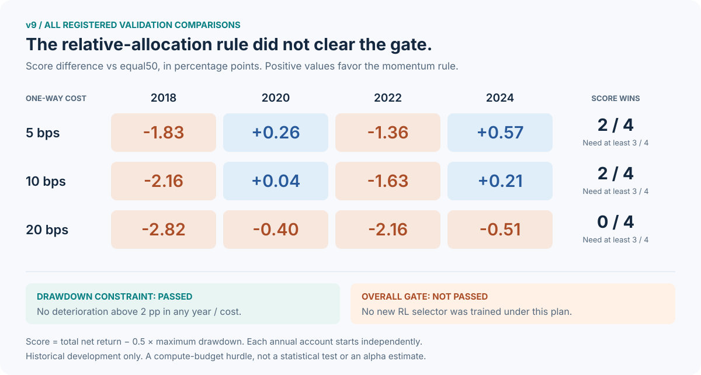

<div align="center">



# multiRL Asset Pricing

**A 股 ETF 组合优化研究 · 多算法强化学习 · 可复核的负结果**

[v9 研究结论](docs/research-results-v9-signal.md) · [完整结果](reports/runs/research_v9_signal/REPORT.md) · [快速开始](#quickstart) · [研究路线](#research-history) · [证据索引](#evidence)

</div>

将组合决策、交易会计与研究验证放在同一条证据链上。本项目研究深度强化学习能否在明确的时间顺序、成本和持仓约束下，提供超越简单规则的组合配置能力。保留全部候选与失败结果，区分**工程正确性、机制改善与投资有效性**。

> **最新状态 · v9（2026-10-27）**
>
> 预先固定的相对配置信号未通过验证门槛，因此 **没有训练新的 RL 选择器**。498 项测试通过与 24 份账本审计通过，证明的是本次工程核验结果，不是收益优势。当前尚未建立稳定的高收益、低回撤优势。

## 项目亮点

| 研究能力 | 实现与边界 |
|---|---|
| **多算法与分层配置** | TD3 / DDPG / SAC / PPO / A2C；冻结策略池上的 DQN、PPO 选择器；风险预算、残差配置与动作掩码。不同版本分别检验，不混称一个最终模型。 |
| **因果时序与真实会计** | 收盘信息决策、下一交易日原始开盘价执行；独立处理分红资格、应收与支付、份额折算和交易费用。 |
| **冻结协议与可追溯证据** | 记录数据、源码、协议与模型哈希；验证选择先冻结，再做测试；同一模型复放 5 / 10 / 20 bps 成本。 |
| **独立核验与诚实报告** | 原始价格重建账户、逐项核对指标、保留全部种子与历史阶段；失败门槛不事后修改。 |



<sub>架构图概括仓库各阶段的能力，不表示 v9 重新运行了所有算法。v7/v8 使用 sb3-contrib MaskablePPO；v9 仅比较固定规则。</sub>

## v9：先检验信号，再决定是否训练

已有选择器主要沿“现金—等权股票篮子”调整暴露。v9 只问一个更窄的问题：**固定总股票目标仓位后，20 日动量排序带来的相对权重差异，是否值得继续投入 RL 训练？**

| 固定项目 | v9 设计 |
|---|---|
| 资产 | `510050`、`510300`、`510500` 三只宽基 ETF |
| 新规则 | `relative_momentum50`：50% 现金；按截至决策日的 20 交易日总收益排序，股票账户权重依次为 1/4、1/6、1/12；同分按代码升序 |
| 对照 | `equal50`：50% 现金，三只 ETF 各 1/6 |
| 执行 | 每 5 个交易日调仓；下日原始开盘价；分红与拆分独立入账 |
| 验证范围 | 2018、2020、2022、2024；每年独立从全现金、净值 1 开始 |
| 成本与规模 | 单边 5 / 10 / 20 bps × 4 年 × 2 规则 = **24 条年度账户路径** |

**预设门槛：**每个成本下，`累计净收益 − 0.5 × 最大回撤` 必须在至少 3/4 年严格胜过 `equal50`；任一年、任一成本的最大回撤恶化不得超过 2 个百分点。所有条件同时满足才允许提出另行审查的 RL 实验。



| 单边成本 | 评分胜出年份 | 要求 | 回撤约束 | 最终门槛 |
|---:|---:|---:|---|---|
| 5 bps | 2 / 4 | ≥ 3 / 4 | 通过 | **未通过** |
| 10 bps | 2 / 4 | ≥ 3 / 4 | 通过 | **未通过** |
| 20 bps | 0 / 4 | ≥ 3 / 4 | 通过 | **未通过** |

图中数值为两规则的**评分差（百分点）**，不是收益率、年化 alpha 或显著性。全部数值来自已归档的 [gate_decision.json](reports/runs/research_v9_signal/gate_decision.json)，并与 [24 行原始指标](reports/runs/research_v9_signal/all_metrics.csv) 交叉核对。

这些年份已经在先前研究中查看过，部分与旧测试期重叠；它们不是新发现的未触碰样本外证据。相同股票目标仓位也不等于相同波动或 beta。该门槛只是预设的计算预算规则，不是统计检验；失败不证明所有相对配置方法都无效。

<a id="quickstart"></a>
## 快速开始

需要 **Python 3.11+、Git**。本 README 对应 `research/v9-relative-signal-gate` 分支；合并前请明确切换到该分支。从项目根目录执行命令。只想了解结论，可直接阅读上方报告，无需下载行情或训练模型。

```bash
git clone https://github.com/Guo-chunyu/multiRL-Asset-Pricing.git
cd multiRL-Asset-Pricing
git checkout research/v9-relative-signal-gate
```

### Windows / PowerShell

```powershell
# 创建独立环境、安装依赖、检出并校验固定版本上游源码
powershell -ExecutionPolicy Bypass -File .\scripts\bootstrap.ps1

# 不依赖 PowerShell 环境激活
.\.venv\Scripts\python.exe -m pytest -q

# 可选：合成数据工程演示，会训练小预算模型，不代表市场表现
.\.venv\Scripts\python.exe -m rlasset.cli demo --output runs/demo_local --steps 512 --seeds 7
```

已有环境或上游源码不会被脚本重置；版本冲突时会中止并保留现场。用 `-CheckOnly` 仅读检查，用 `-VenvPath .venv-clean` 创建另一套环境。

<details>
<summary><strong>Linux / macOS：手动安装等价环境</strong></summary>

```bash
python3 -m venv .venv
source .venv/bin/activate
python -m pip install --upgrade pip
python -m pip install -e ".[data,dev]"

# 仅在全新副本中执行；已有 vendor 目录请先核对，不要覆盖
git clone --no-checkout --depth 1 https://github.com/AI4Finance-Foundation/FinRL.git vendor/FinRL
git -C vendor/FinRL fetch --depth 1 origin 8511e7c15fbe1fbe5eb25e9f89932ac1ecd546a0
git -C vendor/FinRL checkout --detach 8511e7c15fbe1fbe5eb25e9f89932ac1ecd546a0

python -c "from rlasset.finrl_adapter import load_finrl_agent; print(load_finrl_agent()[1]['commit'])"
python -m pytest -q
python -m rlasset.cli demo --output runs/demo_local --steps 512 --seeds 7
```

RLPortfolio 不是必需运行时依赖；研究参考源码固定于 `071cf75da9ddf95ec62210627b971086eec6f18f`，Windows 脚本会同时获取。FinRL 的算法入口与配置另有 SHA-256 校验。

</details>

`demo` 不访问行情服务，但会执行合成数据训练；512 步只用于检查流程，不说明收敛或盈利。每次使用新的输出路径。上述演示属于通用工程入口，**不是 v9 实验**。

## 复核与复现

### 1. 无行情数据也能复核的内容

- 阅读 [v9 预注册协议](docs/research-protocol-v9-signal.md)、[结论](docs/research-results-v9-signal.md) 与 [全部指标](reports/runs/research_v9_signal/all_metrics.csv)。
- 对照 [manifest](reports/runs/research_v9_signal/manifest.json)、[前置审查](reports/runs/research_v9_signal/preflight_review.json)、[独立终审](reports/runs/research_v9_signal/final_review.json) 和 [测试记录](reports/runs/research_v9_signal/pytest_final.log)。
- 运行 `python -m pytest -q tests/test_signal_gate_v9.py` 检查排序、因果前缀、权重、门槛与合成账户回归。
- 运行 `python docs/assets/generate_readme_assets.py --check` 校验图表与已保存结果一致；去掉 `--check` 可重建 SVG，不会回测或训练。

### 2. 完整 v9 复现需要额外输入与审查

公开 Git 仓库包含源码、测试、协议和紧凑研究报告；**不包含原始行情快照、模型 ZIP 或全部逐日账本**。完整本地运行目录为 `runs/`，公开结果镜像为 `reports/runs/`，两者不能互相替代。

v9 要求经核验的原始数据与公司行动文件，及 `restoration_verification.json`、`restoration_audit.json`。仅执行 `scripts/prepare_market_data_v3.py` 下载数据，**不会自动产生 v9 所需认证，也不保证复现原历史快照**。请先核对 [数据纠错与来源说明](docs/data-audit-v3.md) 和 manifest 中的输入哈希；认证缺失或哈希不符应停止，不得伪造通过记录。

满足上述条件后，在已安装环境中使用新目录：

```bash
# 只准备与冻结输入身份，不进行财务评估
python -m rlasset.signal_gate_v9 --stage prepare --data-dir data/v3 --output runs/v9_reproduction

# 暂停：独立审查协议、输入、日历与源码，并记录与 manifest 哈希匹配的通过审查
# 仅在真实审查通过后执行；缺少匹配的 preflight_review.json 会被拒绝
python -m rlasset.signal_gate_v9 --stage evaluate --data-dir data/v3 --output runs/v9_reproduction
```

Windows 将 `python` 替换为 `.\.venv\Scripts\python.exe`。这两个阶段均**不训练 RL**。不要对已归档实验目录重跑或覆盖；规则、数据或源码变化时需新协议、新目录及重新审查。v9 未通过门槛，不能据此计划继续训练新选择器。

<a id="research-history"></a>
## 研究路线：每一轮都留下可复查的结论

| 阶段 | 核心问题 | 已建立的结论与边界 | 文档 |
|---|---|---|---|
| v1–v2 | 多算法、DQN 选择器与模拟成交 | 发现腾讯 hfq 加法复权问题；旧市场绩效解释**已撤回**，记录保留 | [纠错](docs/data-audit-v3.md) · [历史结果](docs/results-v2.md) |
| v3 | 原始价格与公司行动会计 | 修复收益口径，完成长历史重测；未稳定优于简单组合 | [协议](docs/research-protocol-v3.md) · [结果](docs/results-v3.md) |
| v4 | 信息增量 × 风险预算 | 风险配置更明确；未证明稳定收益信息或跨期优势 | [协议](docs/research-protocol-v4.md) · [结果](docs/results-v4.md) |
| v5 | 规则锚点上的 PPO 残差 | 未证明相对自身规则锚点的可靠增益 | [协议](docs/research-protocol-v5.md) · [结果](docs/research-results-v5.md) |
| v6 | 固定专家上的 PPO 选择器 | 多数行为接近固定专家，未建立有用的动态轮换优势 | [协议](docs/research-protocol-v6.md) · [结果](docs/research-results-v6.md) |
| v7 | 因果动作掩码对照 | 局部改善伴随种子依赖与其他阶段风险恶化 | [协议](docs/research-protocol-v7.md) · [结果](docs/research-results-v7.md) |
| v8 | 仅归一化历史计数观测 | 神经响应改善，不等于交易优势；未提升为默认策略 | [协议](docs/research-protocol-v8.md) · [结果](docs/research-results-v8.md) |
| **v9** | **固定相对配置信号门槛** | **2/4、2/4、0/4 年评分胜出；门槛失败，停止该计划下的新 RL 训练** | [协议](docs/research-protocol-v9-signal.md) · [结果](docs/research-results-v9-signal.md) |

> **数据口径警示：**v1/v2 的 hfq 价格比不能继续作为可交易总收益证据。v3 之后改用原始价格、独立分红与份额折算会计；资产池也不同，不能把跨版本收益差直接称为算法提升。通用旧 `download/train` 入口不等同于纠正后的 v3–v9 研究流程。

<a id="evidence"></a>
## 证据索引与代码地图

| 想看什么 | 从这里开始 |
|---|---|
| v9 全部结果，不只看赢家 | [REPORT.md](reports/runs/research_v9_signal/REPORT.md) · [all_metrics.csv](reports/runs/research_v9_signal/all_metrics.csv) |
| 门槛与独立核验 | [gate_decision.json](reports/runs/research_v9_signal/gate_decision.json) · [final_review.json](reports/runs/research_v9_signal/final_review.json) |
| v9 规则与回归测试 | [signal_gate_v9.py](src/rlasset/signal_gate_v9.py) · [test_signal_gate_v9.py](tests/test_signal_gate_v9.py) |
| 账户环境与公司行动 | [robust_env.py](src/rlasset/robust_env.py) · [corporate_actions.py](src/rlasset/corporate_actions.py) · [独立审计器](scripts/audit_research_v3.py) |
| 算法入口与选择器 | [FinRL 适配器](src/rlasset/finrl_adapter.py) · [PPO 专家选择器](src/rlasset/selector_env_v6.py) · [掩码选择器](src/rlasset/masked_selector_v7.py) |
| 模拟成交与理论基准 | [执行引擎说明](docs/execution.md) · [DDPO 研究记录](docs/research/ddpo.md) |
| 研究来源与框架边界 | [MetaTrader](docs/research/metatrader.md) · [FinRL / RLPortfolio](docs/research/frameworks.md) · [第三方声明](THIRD_PARTY_NOTICES.md) |

```text
src/rlasset/       # 环境、算法适配器、研究流水线、指标与模拟成交
tests/            # 因果性、账户会计、策略约束与实验协议回归测试
docs/             # 研究协议、逐版结论、数据纠错与架构图
reports/runs/     # 随 Git 发布的紧凑证据与指标
scripts/          # 安装、数据准备、独立审计与结果导出
data/ · runs/     # 本地行情与完整实验产物（不随 Git 发布）
```

v9 终审记录：**24** 份账户独立重建，**1,176** 次计划因果目标检查，最大账户重建误差约 **1.51 × 10⁻¹⁴**；当轮全量测试 **498 passed**。详见可追溯日志，以上为已归档结果，不是实时 CI 徽章。

## 研究边界

- **回顾性、探索性研究。**历史已反复查看，有限种子共享同一市场样本；种子均值不是可交易组合，独立年度或折不能拼成连续净值。
- **风险暴露必须一起看。**低回撤可能来自更多现金；目标波动预算不保证实际波动、回撤上限或风险调整后超额收益。
- **数据与复现仍有限制。**固定存续 ETF、不完整的历史时点数据库、外部数据源可用性，以及恢复快照后的新跨源核验失败，均已披露。依赖部分使用版本范围，`pyproject.toml` 不是完整锁文件。
- **回测不等于成交。**研究环境使用分数份额和假定开盘成交；独立 paper 模块可检查整数份额、最低佣金、T+1、停牌、涨跌停与部分成交，但没有真实盘口、订单路由或实盘收益证据。
- **不构成投资建议。**当前不推荐任何策略用于实盘；下一步需要另行冻结假设与比较规则，并积累真正未查看的新数据，而不是继续在同一历史区间寻找赢家。

---

<div align="center">
<strong>可审计的实现，可复核的结果，清晰的研究边界。</strong><br>
<sub>原生 SVG 图示随仓库保存，无外部图片服务；结果图可从已归档指标确定性重建。</sub>
</div>
