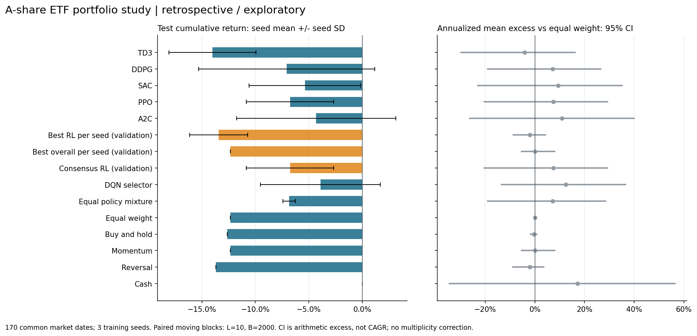
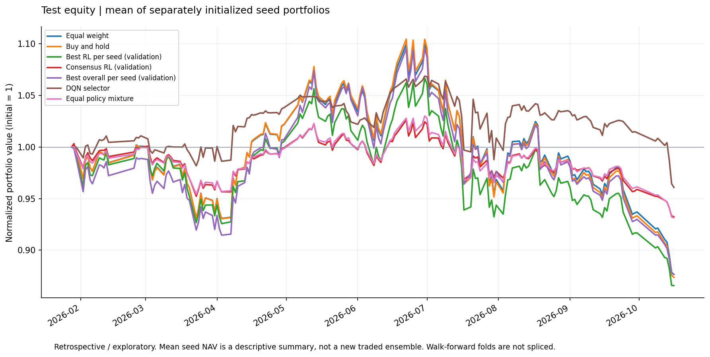

# A 股 ETF 深度强化学习比较：回顾性研究

本轮使用已经被研究过程查看过的历史测试区间，因此所有新增算法、消融及推断均属于**回顾性 / 探索性**研究。代码中的时间隔离不能恢复研究者层面的未见测试集；不得将本报告称为全新、未经查看的样本外验证。

主实验测试收益覆盖 2026-01-29 至 2026-10-16，共 170 个交易日；训练种子为 [7, 17, 29]。每个基础算法请求 10000 步，成本假设为 5.0 bps；训练风险参数为 [2.0]。

## 主要比较

逐种子验证期选出的最佳 RL（`best_rl_on_validation`）平均测试累计收益为 -13.43%，种子收益标准差为 2.72%。相对等权的年化算术平均日超额为 -2.07%，95% 区间为 [-9.00%, 4.56%]。区间包含零，当前样本不足以支持相对等权存在稳定超额的结论。

统一算法由 5 个候选的跨种子**验证期**平均 `累计收益 - 0.5 × 最大回撤` 排名决定：本次为 `ppo`。其全部种子的平均测试累计收益为 -6.76%，种子标准差为 4.08%。此选择未挑选最好 seed，也未用测试收益选择算法；它保留为 `consensus_validation_algorithm`，不覆盖逐种子选择结果。候选算法数量以实际配置为准。

| 验证期排名 | 算法 / 策略 | 平均验证得分 | 得分种子标准差 |
|---:|---|---:|---:|
| 1 | `ppo` | 13.04% | 8.35% |
| 2 | `ddpg` | 12.70% | 15.79% |
| 3 | `sac` | 11.08% | 11.24% |
| 4 | `a2c` | 8.83% | 15.28% |
| 5 | `td3_risk_2` | 0.64% | 17.54% |

## 主实验完整比较

| 策略 | 种子平均累计收益 | 种子收益标准差 | 平均最大回撤 | 日均双边换手 | 年化算术超额均值 | 95% 区间 | 包含零 |
|---|---:|---:|---:|---:|---:|---|:---:|
| `a2c` | -4.31% | 7.46% | 4.96% | 0.37% | 10.90% | [-26.53%, 40.20%] | 是 |
| `best_rl_on_validation` | -13.43% | 2.72% | 18.64% | 11.58% | -2.07% | [-9.00%, 4.56%] | 是 |
| `buy_hold` | -12.63% | 0.00% | 20.90% | 0.59% | -0.39% | [-2.07%, 1.01%] | 是 |
| `cash` | 0.00% | 0.00% | 0.00% | 0.00% | 17.14% | [-34.75%, 56.66%] | 是 |
| `consensus_validation_algorithm` | -6.76% | 4.08% | 9.35% | 0.73% | 7.37% | [-20.71%, 29.57%] | 是 |
| `ddpg` | -7.07% | 8.24% | 10.81% | 11.53% | 7.13% | [-19.21%, 26.73%] | 是 |
| `dqn_selector` | -3.92% | 5.62% | 10.67% | 27.10% | 12.38% | [-13.69%, 36.74%] | 是 |
| `equal_mixture` | -6.85% | 0.58% | 9.55% | 3.77% | 7.19% | [-19.28%, 28.63%] | 是 |
| `equal_weight` | -12.35% | 0.00% | 20.31% | 1.18% | -0.00% | [-0.00%, 0.00%] | 是 |
| `momentum` | -12.34% | 0.00% | 19.97% | 8.23% | -0.00% | [-5.59%, 8.27%] | 是 |
| `ppo` | -6.76% | 4.08% | 9.35% | 0.73% | 7.37% | [-20.71%, 29.57%] | 是 |
| `reversal` | -13.71% | 0.00% | 21.30% | 8.62% | -2.07% | [-9.18%, 3.75%] | 是 |
| `sac` | -5.37% | 5.21% | 6.91% | 0.47% | 9.32% | [-23.29%, 35.36%] | 是 |
| `selected_on_validation` | -12.34% | 0.00% | 19.97% | 8.23% | -0.00% | [-5.59%, 8.27%] | 是 |
| `td3_risk_2` | -14.02% | 4.08% | 16.87% | 85.11% | -4.09% | [-30.03%, 16.49%] | 是 |

累计收益、回撤和换手先在每个种子内计算，再取种子均值；标准差采用样本标准差，表示训练随机性。等权基准只有一条共同市场路径，三个 seed 不构成三个独立市场样本。图中净值是各 seed 净值的平均，它与“逐日平均收益后复利”不同，两者均在 JSON 中保留。

置信区间使用各 seed 在同一天的平均日收益减等权日收益，做配对、非环绕的重叠移动区块 bootstrap：固定区块长度 10、重抽样 2000 次、置信度 95%、随机种子 7。区间量纲为 252 × 平均日超额，即年化算术超额；它不是累计收益差或 CAGR 的区间，不代表未来获胜概率。区间条件于这些已训练模型，未重训模型，也未校正多重比较。正收益本身不等于优于基准；包含零必须明确报告。

## 验证期选择记录

| 训练种子 | 最佳 RL | 全候选最佳（包括现金） |
|---:|---|---|
| 7 | `a2c` | `momentum` |
| 17 | `ddpg` | `momentum` |
| 29 | `sac` | `momentum` |

## 训练计算成本

墙钟时间受并发负载和硬件影响，不是算法复杂度的严格比较。DQN 另有训练预算，其依赖的基础模型成本不能忽略。

| 模型 | 平均训练秒数 | 秒数标准差 | 请求步数（按 seed） | 实际步数（按 seed） |
|---|---:|---:|---|---|
| `td3_risk_2` | 89.01 | 2.21 | [10000, 10000, 10000] | [10000, 10000, 10000] |
| `ddpg` | 106.01 | 10.13 | [10000, 10000, 10000] | [10000, 10000, 10000] |
| `sac` | 132.25 | 12.62 | [10000, 10000, 10000] | [10000, 10000, 10000] |
| `ppo` | 18.53 | 2.07 | [10000, 10000, 10000] | [10000, 10000, 10000] |
| `a2c` | 17.68 | 1.46 | [10000, 10000, 10000] | [10000, 10000, 10000] |
| `dqn_selector` | 88.59 | 8.65 | [10000, 10000, 10000] | [10000, 10000, 10000] |

## 扩展窗口检验

各折独立从现金重置，分别计算指标和 bootstrap；**不拼接**为连续净值，不让区块跨折，也不把不同折或训练种子当成独立市场来增加显著性。后续折合法使用此前已发生的数据作为训练历史。

### 第 1 折

收益日期 2025-05-14 至 2025-10-30，115 日；训练预算 5000 步 / 算法 / seed。本折验证期统一算法为 `a2c`。

本折逐种子最佳 RL 平均累计收益 0.13%，等权为 29.07%；年化算术超额的 95% 区间为 [-93.98%, -22.70%]。区间完全低于零，提示该历史样本内落后于等权；仍为未经多重比较校正的探索性比较。

| 策略 | 种子平均累计收益 | 种子收益标准差 | 平均最大回撤 | 日均双边换手 | 年化算术超额均值 | 95% 区间 | 包含零 |
|---|---:|---:|---:|---:|---:|---|:---:|
| `a2c` | 4.77% | 8.16% | 1.18% | 0.23% | -47.29% | [-77.77%, -18.77%] | 否 |
| `best_rl_on_validation` | 0.13% | 0.13% | 0.03% | 0.01% | -56.93% | [-93.98%, -22.70%] | 否 |
| `buy_hold` | 29.96% | 0.00% | 5.82% | 0.87% | 1.61% | [-1.14%, 3.64%] | 是 |
| `cash` | 0.00% | 0.00% | 0.00% | 0.00% | -57.21% | [-94.48%, -22.83%] | 否 |
| `consensus_validation_algorithm` | 4.77% | 8.16% | 1.18% | 0.23% | -47.29% | [-77.77%, -18.77%] | 否 |
| `ddpg` | 17.67% | 14.55% | 3.86% | 34.28% | -21.92% | [-34.40%, -9.34%] | 否 |
| `dqn_selector` | 4.81% | 2.06% | 2.38% | 4.73% | -46.76% | [-79.75%, -19.58%] | 否 |
| `equal_mixture` | 13.91% | 0.44% | 2.85% | 0.88% | -28.35% | [-46.69%, -11.24%] | 否 |
| `equal_weight` | 29.07% | 0.00% | 5.38% | 1.30% | -0.00% | [-0.00%, 0.00%] | 是 |
| `momentum` | 32.57% | 0.00% | 6.70% | 6.46% | 6.27% | [-4.53%, 19.44%] | 是 |
| `ppo` | 14.14% | 17.79% | 2.75% | 0.62% | -29.31% | [-48.57%, -12.03%] | 否 |
| `reversal` | 26.48% | 0.00% | 4.34% | 6.03% | -4.72% | [-13.88%, 2.78%] | 是 |
| `sac` | 19.54% | 1.45% | 3.84% | 0.97% | -17.45% | [-28.81%, -6.41%] | 否 |
| `selected_on_validation` | 4.81% | 2.06% | 2.38% | 4.73% | -46.76% | [-79.75%, -19.58%] | 否 |
| `td3_risk_2` | 6.89% | 7.08% | 1.56% | 0.50% | -42.76% | [-70.14%, -16.74%] | 否 |

### 第 2 折

收益日期 2025-11-03 至 2026-04-23，115 日；训练预算 5000 步 / 算法 / seed。本折验证期统一算法为 `sac`。

本折逐种子最佳 RL 平均累计收益 7.45%，等权为 8.05%；年化算术超额的 95% 区间为 [-9.01%, 7.87%]。区间包含零，不能据此声称稳定超额。

| 策略 | 种子平均累计收益 | 种子收益标准差 | 平均最大回撤 | 日均双边换手 | 年化算术超额均值 | 95% 区间 | 包含零 |
|---|---:|---:|---:|---:|---:|---|:---:|
| `a2c` | 1.64% | 3.84% | 4.83% | 0.59% | -14.54% | [-41.93%, 13.26%] | 是 |
| `best_rl_on_validation` | 7.45% | 1.20% | 8.08% | 1.16% | -1.43% | [-9.01%, 7.87%] | 是 |
| `buy_hold` | 8.13% | 0.00% | 7.37% | 0.87% | 0.19% | [-0.77%, 1.06%] | 是 |
| `cash` | 0.00% | 0.00% | 0.00% | 0.00% | -18.35% | [-62.97%, 27.63%] | 是 |
| `consensus_validation_algorithm` | 5.94% | 2.40% | 5.60% | 1.06% | -4.92% | [-16.65%, 6.95%] | 是 |
| `ddpg` | 1.26% | 7.13% | 5.92% | 38.51% | -15.49% | [-38.51%, 8.05%] | 是 |
| `dqn_selector` | 2.02% | 3.70% | 5.18% | 13.08% | -13.76% | [-46.55%, 21.81%] | 是 |
| `equal_mixture` | 4.01% | 2.27% | 4.97% | 7.32% | -9.28% | [-27.22%, 9.55%] | 是 |
| `equal_weight` | 8.05% | 0.00% | 7.24% | 1.34% | -0.00% | [-0.00%, 0.00%] | 是 |
| `momentum` | 8.30% | 0.00% | 8.82% | 7.44% | 0.65% | [-7.82%, 8.36%] | 是 |
| `ppo` | 3.02% | 4.09% | 4.89% | 0.72% | -11.37% | [-33.59%, 11.34%] | 是 |
| `reversal` | 7.64% | 0.00% | 7.21% | 7.48% | -0.91% | [-6.49%, 5.48%] | 是 |
| `sac` | 5.94% | 2.40% | 5.60% | 1.06% | -4.92% | [-16.65%, 6.95%] | 是 |
| `selected_on_validation` | 8.30% | 0.00% | 8.82% | 7.44% | 0.65% | [-7.82%, 8.36%] | 是 |
| `td3_risk_2` | 8.18% | 1.52% | 7.99% | 1.06% | -0.03% | [-12.98%, 16.30%] | 是 |

### 第 3 折

收益日期 2026-04-27 至 2026-10-16，115 日；训练预算 5000 步 / 算法 / seed。本折验证期统一算法为 `sac`。

本折逐种子最佳 RL 平均累计收益 -8.08%，等权为 -13.51%；年化算术超额的 95% 区间为 [-9.52%, 29.87%]。区间包含零，不能据此声称稳定超额。

| 策略 | 种子平均累计收益 | 种子收益标准差 | 平均最大回撤 | 日均双边换手 | 年化算术超额均值 | 95% 区间 | 包含零 |
|---|---:|---:|---:|---:|---:|---|:---:|
| `a2c` | -3.05% | 4.93% | 4.73% | 0.33% | 22.54% | [-21.13%, 60.84%] | 是 |
| `best_rl_on_validation` | -8.08% | 0.91% | 12.68% | 0.91% | 11.63% | [-9.52%, 29.87%] | 是 |
| `buy_hold` | -13.49% | 0.00% | 20.34% | 0.87% | 0.05% | [-1.43%, 0.93%] | 是 |
| `cash` | 0.00% | 0.00% | 0.00% | 0.00% | 29.13% | [-30.03%, 80.63%] | 是 |
| `consensus_validation_algorithm` | -9.36% | 0.49% | 14.46% | 1.07% | 8.89% | [-9.97%, 25.31%] | 是 |
| `ddpg` | -4.13% | 3.53% | 7.13% | 15.21% | 20.34% | [-18.12%, 54.92%] | 是 |
| `dqn_selector` | -11.57% | 2.30% | 16.33% | 13.55% | 4.35% | [-10.40%, 17.08%] | 是 |
| `equal_mixture` | -5.80% | 0.81% | 8.89% | 0.92% | 16.58% | [-16.93%, 45.91%] | 是 |
| `equal_weight` | -13.51% | 0.00% | 20.31% | 1.49% | -0.00% | [-0.00%, 0.00%] | 是 |
| `momentum` | -12.37% | 0.00% | 19.97% | 8.55% | 2.74% | [-8.22%, 11.22%] | 是 |
| `ppo` | -7.63% | 3.10% | 11.55% | 0.97% | 12.61% | [-12.73%, 34.94%] | 是 |
| `reversal` | -15.42% | 0.00% | 21.30% | 9.21% | -4.50% | [-12.41%, 5.93%] | 是 |
| `sac` | -9.36% | 0.49% | 14.46% | 1.07% | 8.89% | [-9.97%, 25.31%] | 是 |
| `selected_on_validation` | -13.49% | 0.00% | 20.34% | 0.87% | 0.05% | [-1.43%, 0.93%] | 是 |
| `td3_risk_2` | -5.17% | 3.05% | 7.98% | 0.94% | 18.06% | [-17.10%, 49.37%] | 是 |

## 解释边界

数据是固定 ETF 集合和事后复权快照，存在标的选择、时间段选择与数据版本限制。模拟考虑下一开盘交易、隔夜持仓收益和比例成本，但不等同于实际可成交结果；逐笔成交、整手、涨跌停、停牌、容量、冲击和其他真实执行限制需要另行验证。本报告提供研究比较，不构成收益承诺。

数据 SHA-256：`64c84ef0588d2a8086e7dd56987d1ce75d6f5fe3d9b155e0cf21711012d9145c`。完整指标、逐 seed 结果和逐折区间见 `analysis.json`。
