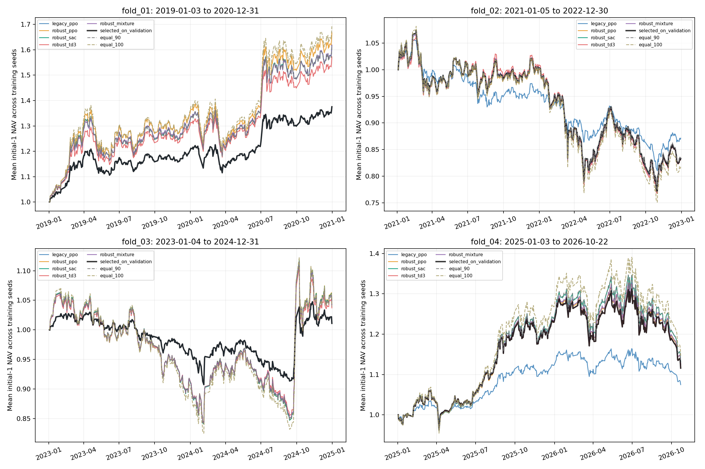
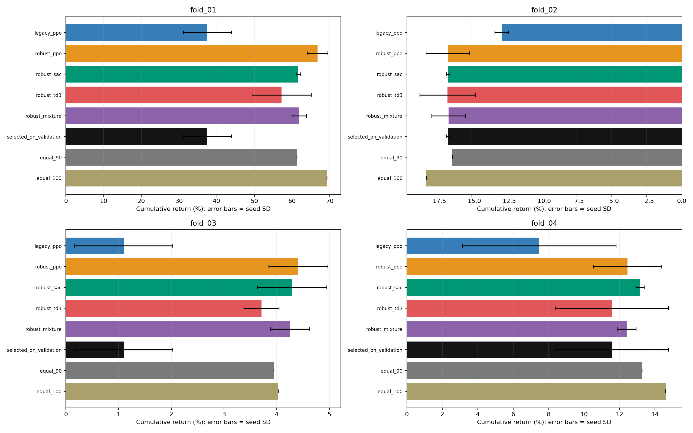

# A 股 ETF 组合优化：v3 历史研究

本报告来自真实历史原始价格与现金分红、份额拆分账本。旧版腾讯 hfq 收益口径不适合直接计算投资收益，本研究重新计算。
这是回溯探索性研究，不是实盘业绩，也不是从未接触历史后得到的严格样本外证明。

每折独立从净值 1 开始，分别报告；不拼接为连续投资净值。所有候选均展示，选中策略只读取冻结的验证期结果。
累计收益、年化收益、Sharpe、最大回撤等均先逐种子计算，再报告均值 ± 样本标准差。种子反映训练随机性，不能当作三段独立市场。
主表、累计收益柱图和 metrics.csv 的累计收益均采用种子累计收益的算术平均；净值图为种子净值的算术平均，因此其期末净值减 1 与该累计收益一致。
年化采用每年 252 个交易日；Sharpe 无风险利率取 0；换手率为日均买卖成交额双边合计/NAV；现金栏包含尚未到账的应收分红。

下载实验数据：[指标与种子标准差](metrics.csv)、[成对超额收益区间](excess_intervals.csv)。CSV 的收益、回撤、换手和现金占比均用小数表示（0.10=10%），未定义值留空。

## 主实验：单边交易费率 5 bps

### fold_01：2019-01-03 至 2020-12-31

有效收益日 486；验证期冻结选择 `legacy_ppo`。

| 策略 | 累计收益 | 年化收益 | Sharpe | 最大回撤 | 日均换手 | 平均现金及应收 |
|---|---:|---:|---:|---:|---:|---:|
| legacy_ppo | 37.55% ± 6.36% | 17.95% ± 2.84% | 1.37 ± 0.13 | 10.05% ± 2.01% | 0.56% ± 0.21% | 41.06% ± 11.14% |
| robust_ppo | 66.73% ± 2.73% | 30.35% ± 1.10% | 1.39 ± 0.05 | 14.58% ± 0.70% | 0.51% ± 0.11% | 3.28% ± 5.62% |
| robust_sac | 61.65% ± 0.61% | 28.28% ± 0.25% | 1.39 ± 0.00 | 13.43% ± 0.23% | 0.66% ± 0.25% | 9.93% ± 0.83% |
| robust_td3 | 57.22% ± 7.86% | 26.42% ± 3.26% | 1.42 ± 0.09 | 12.27% ± 0.55% | 1.56% ± 1.53% | 16.72% ± 4.72% |
| robust_mixture | 61.87% ± 1.89% | 28.36% ± 0.78% | 1.40 ± 0.04 | 13.39% ± 0.17% | 0.76% ± 0.34% | 9.98% ± 0.59% |
| selected_on_validation | 37.55% ± 6.36% | 17.95% ± 2.84% | 1.37 ± 0.13 | 10.05% ± 2.01% | 0.56% ± 0.21% | 41.06% ± 11.14% |
| equal_80 | 53.56% | 24.91% | 1.38 | 12.00% | 0.29% | 19.95% |
| equal_90 | 61.30% | 28.13% | 1.38 | 13.42% | 0.31% | 9.98% |
| equal_100 | 69.26% | 31.37% | 1.38 | 14.83% | 0.34% | 0.02% |
| buy_hold | 68.03% | 30.88% | 1.38 | 14.60% | 0.21% | 1.01% |
| inverse_vol_90 | 61.63% | 28.27% | 1.39 | 13.47% | 0.49% | 9.98% |

基准每折仅有一条路径，因此没有种子标准差。`equal_90` 是与新策略风险资产暴露接近的控制，`equal_100` 表示满仓等权；不能把降低仓位带来的回撤下降全归因于 RL。

| 策略 | 对 equal_90 年化日均超额 95% 区间 | 对 equal_100 年化日均超额 95% 区间 |
|---|---:|---:|
| legacy_ppo | [-18.35%, 1.18%] | [-24.03%, 1.48%] |
| robust_ppo | [-0.25%, 3.81%] | [-2.53%, 0.87%] |
| robust_sac | [-0.13%, 0.36%] | [-5.57%, 0.42%] |
| robust_td3 | [-5.21%, 2.06%] | [-10.77%, 2.16%] |
| robust_mixture | [-0.88%, 1.10%] | [-6.18%, 1.14%] |
| selected_on_validation | [-18.35%, 1.18%] | [-24.03%, 1.48%] |

### fold_02：2021-01-05 至 2022-12-30

有效收益日 484；验证期冻结选择 `robust_sac`。

| 策略 | 累计收益 | 年化收益 | Sharpe | 最大回撤 | 日均换手 | 平均现金及应收 |
|---|---:|---:|---:|---:|---:|---:|
| legacy_ppo | -12.87% ± 0.50% | -6.92% ± 0.28% | -0.64 ± 0.01 | 23.24% ± 1.10% | 0.39% ± 0.07% | 47.96% ± 2.61% |
| robust_ppo | -16.73% ± 1.56% | -9.09% ± 0.88% | -0.50 ± 0.02 | 28.37% ± 2.23% | 0.60% ± 0.10% | 9.15% ± 4.62% |
| robust_sac | -16.69% ± 0.12% | -9.07% ± 0.07% | -0.51 ± 0.00 | 28.11% ± 0.28% | 0.74% ± 0.08% | 9.80% ± 0.80% |
| robust_td3 | -16.75% ± 1.98% | -9.10% ± 1.12% | -0.48 ± 0.03 | 27.96% ± 2.55% | 2.01% ± 1.44% | 4.82% ± 6.79% |
| robust_mixture | -16.67% ± 1.21% | -9.06% ± 0.69% | -0.50 ± 0.02 | 28.12% ± 1.65% | 0.90% ± 0.34% | 7.91% ± 3.87% |
| selected_on_validation | -16.69% ± 0.12% | -9.07% ± 0.07% | -0.51 ± 0.00 | 28.11% ± 0.28% | 0.74% ± 0.08% | 9.80% ± 0.80% |
| equal_80 | -14.54% | -7.86% | -0.50 | 25.04% | 0.30% | 20.00% |
| equal_90 | -16.40% | -8.91% | -0.50 | 27.83% | 0.32% | 10.01% |
| equal_100 | -18.27% | -9.97% | -0.50 | 30.55% | 0.35% | 0.02% |
| buy_hold | -17.94% | -9.78% | -0.50 | 29.63% | 0.21% | 1.00% |
| inverse_vol_90 | -15.72% | -8.52% | -0.48 | 27.11% | 0.52% | 10.01% |

基准每折仅有一条路径，因此没有种子标准差。`equal_90` 是与新策略风险资产暴露接近的控制，`equal_100` 表示满仓等权；不能把降低仓位带来的回撤下降全归因于 RL。

| 策略 | 对 equal_90 年化日均超额 95% 区间 | 对 equal_100 年化日均超额 95% 区间 |
|---|---:|---:|
| legacy_ppo | [-7.92%, 11.63%] | [-8.64%, 14.49%] |
| robust_ppo | [-0.51%, 0.13%] | [-1.13%, 2.91%] |
| robust_sac | [-0.48%, 0.02%] | [-1.24%, 3.10%] |
| robust_td3 | [-1.60%, 1.65%] | [-0.96%, 3.01%] |
| robust_mixture | [-0.68%, 0.50%] | [-0.96%, 2.91%] |
| selected_on_validation | [-0.48%, 0.02%] | [-1.24%, 3.10%] |

### fold_03：2023-01-04 至 2024-12-31

有效收益日 483；验证期冻结选择 `legacy_ppo`。

| 策略 | 累计收益 | 年化收益 | Sharpe | 最大回撤 | 日均换手 | 平均现金及应收 |
|---|---:|---:|---:|---:|---:|---:|
| legacy_ppo | 1.10% ± 0.93% | 0.57% ± 0.48% | 0.19 ± 0.12 | 11.77% ± 9.77% | 0.28% ± 0.22% | 59.35% ± 34.27% |
| robust_ppo | 4.41% ± 0.56% | 2.28% ± 0.29% | 0.22 ± 0.02 | 20.88% ± 1.23% | 0.64% ± 0.14% | 9.07% ± 4.55% |
| robust_sac | 4.29% ± 0.66% | 2.22% ± 0.34% | 0.21 ± 0.02 | 20.95% ± 0.32% | 0.76% ± 0.12% | 9.15% ± 0.47% |
| robust_td3 | 3.71% ± 0.33% | 1.92% ± 0.17% | 0.20 ± 0.01 | 20.45% ± 1.59% | 2.34% ± 0.64% | 15.08% ± 4.51% |
| robust_mixture | 4.26% ± 0.37% | 2.20% ± 0.19% | 0.21 ± 0.01 | 20.72% ± 0.22% | 0.90% ± 0.17% | 11.08% ± 1.15% |
| selected_on_validation | 1.10% ± 0.93% | 0.57% ± 0.48% | 0.19 ± 0.12 | 11.77% ± 9.77% | 0.28% ± 0.22% | 59.35% ± 34.27% |
| equal_80 | 3.80% | 1.96% | 0.21 | 18.64% | 0.28% | 20.01% |
| equal_90 | 3.95% | 2.04% | 0.20 | 20.77% | 0.30% | 10.02% |
| equal_100 | 4.03% | 2.08% | 0.20 | 22.87% | 0.33% | 0.03% |
| buy_hold | 3.52% | 1.82% | 0.19 | 22.68% | 0.21% | 1.33% |
| inverse_vol_90 | 4.82% | 2.49% | 0.23 | 20.23% | 0.58% | 10.02% |

基准每折仅有一条路径，因此没有种子标准差。`equal_90` 是与新策略风险资产暴露接近的控制，`equal_100` 表示满仓等权；不能把降低仓位带来的回撤下降全归因于 RL。

| 策略 | 对 equal_90 年化日均超额 95% 区间 | 对 equal_100 年化日均超额 95% 区间 |
|---|---:|---:|
| legacy_ppo | [-17.05%, 10.82%] | [-20.68%, 13.18%] |
| robust_ppo | [-0.20%, 0.87%] | [-2.81%, 2.29%] |
| robust_sac | [-0.29%, 0.80%] | [-2.79%, 2.11%] |
| robust_td3 | [-2.09%, 1.25%] | [-5.50%, 3.47%] |
| robust_mixture | [-0.21%, 0.44%] | [-3.63%, 2.64%] |
| selected_on_validation | [-17.05%, 10.82%] | [-20.68%, 13.18%] |

### fold_04：2025-01-03 至 2026-10-22

有效收益日 434；验证期冻结选择 `robust_td3`。

| 策略 | 累计收益 | 年化收益 | Sharpe | 最大回撤 | 日均换手 | 平均现金及应收 |
|---|---:|---:|---:|---:|---:|---:|
| legacy_ppo | 7.47% ± 4.34% | 4.26% ± 2.43% | 0.49 ± 0.12 | 8.74% ± 4.29% | 0.32% ± 0.06% | 49.66% ± 0.37% |
| robust_ppo | 12.45% ± 1.91% | 7.05% ± 1.06% | 0.53 ± 0.04 | 15.19% ± 2.09% | 0.50% ± 0.14% | 11.23% ± 8.48% |
| robust_sac | 13.17% ± 0.23% | 7.45% ± 0.13% | 0.54 ± 0.01 | 15.94% ± 0.45% | 0.72% ± 0.08% | 9.78% ± 1.29% |
| robust_td3 | 11.57% ± 3.20% | 6.56% ± 1.77% | 0.50 ± 0.06 | 14.95% ± 1.96% | 2.13% ± 0.74% | 11.95% ± 10.46% |
| robust_mixture | 12.42% ± 0.52% | 7.03% ± 0.29% | 0.53 ± 0.01 | 15.34% ± 0.30% | 0.95% ± 0.30% | 10.98% ± 3.55% |
| selected_on_validation | 11.57% ± 3.20% | 6.56% ± 1.77% | 0.50 ± 0.06 | 14.95% ± 1.96% | 2.13% ± 0.74% | 11.95% ± 10.46% |
| equal_80 | 11.91% | 6.75% | 0.54 | 14.29% | 0.31% | 20.02% |
| equal_90 | 13.27% | 7.50% | 0.55 | 15.95% | 0.34% | 10.04% |
| equal_100 | 14.60% | 8.23% | 0.55 | 17.59% | 0.38% | 0.06% |
| buy_hold | 14.61% | 8.24% | 0.55 | 17.81% | 0.23% | 1.82% |
| inverse_vol_90 | 12.48% | 7.07% | 0.53 | 14.78% | 0.50% | 10.04% |

基准每折仅有一条路径，因此没有种子标准差。`equal_90` 是与新策略风险资产暴露接近的控制，`equal_100` 表示满仓等权；不能把降低仓位带来的回撤下降全归因于 RL。

| 策略 | 对 equal_90 年化日均超额 95% 区间 | 对 equal_100 年化日均超额 95% 区间 |
|---|---:|---:|
| legacy_ppo | [-14.91%, 4.87%] | [-18.25%, 5.95%] |
| robust_ppo | [-1.72%, 0.53%] | [-4.91%, 1.42%] |
| robust_sac | [-0.34%, 0.22%] | [-3.61%, 1.11%] |
| robust_td3 | [-2.84%, 0.57%] | [-5.90%, 1.18%] |
| robust_mixture | [-1.54%, 0.30%] | [-4.79%, 1.21%] |
| selected_on_validation | [-2.84%, 0.57%] | [-5.90%, 1.18%] |

区间使用逐日对齐的种子平均收益，与单条基准路径进行 10 日移动分块成对 bootstrap（2000 次）。
区间估计的是 252×日均算术超额，不是复合年化收益区间；没有多重比较校正。区间包含 0 时，不能据此确认稳定超额收益。

## 交易成本压力测试

同一冻结模型在更高成本下重新执行；模型不再训练，持仓反馈和动作可能随成本改变。

| 折 | 策略 | 5 bps 累计收益 | 10 bps 累计收益 | 20 bps 累计收益 |
|---|---|---:|---:|---:|
| fold_01 | legacy_ppo | 37.55% ± 6.36% | 37.36% ± 6.28% | 36.98% ± 6.13% |
| fold_01 | robust_ppo | 66.73% ± 2.73% | 66.52% ± 2.72% | 66.11% ± 2.70% |
| fold_01 | robust_sac | 61.65% ± 0.61% | 61.39% ± 0.61% | 60.87% ± 0.67% |
| fold_01 | robust_td3 | 57.22% ± 7.86% | 56.63% ± 7.98% | 55.46% ± 8.31% |
| fold_01 | robust_mixture | 61.87% ± 1.89% | 61.57% ± 1.96% | 60.98% ± 2.11% |
| fold_01 | selected_on_validation | 37.55% ± 6.36% | 37.36% ± 6.28% | 36.98% ± 6.13% |
| fold_01 | equal_80 | 53.56% | 53.45% | 53.23% |
| fold_01 | equal_90 | 61.30% | 61.18% | 60.93% |
| fold_01 | equal_100 | 69.26% | 69.12% | 68.84% |
| fold_01 | buy_hold | 68.03% | 67.94% | 67.78% |
| fold_01 | inverse_vol_90 | 61.63% | 61.44% | 61.06% |
| fold_02 | legacy_ppo | -12.87% ± 0.50% | -12.95% ± 0.51% | -13.12% ± 0.54% |
| fold_02 | robust_ppo | -16.73% ± 1.56% | -16.85% ± 1.57% | -17.09% ± 1.61% |
| fold_02 | robust_sac | -16.69% ± 0.12% | -16.84% ± 0.10% | -17.13% ± 0.07% |
| fold_02 | robust_td3 | -16.75% ± 1.98% | -17.15% ± 1.78% | -17.96% ± 1.48% |
| fold_02 | robust_mixture | -16.67% ± 1.21% | -16.85% ± 1.17% | -17.22% ± 1.09% |
| fold_02 | selected_on_validation | -16.69% ± 0.12% | -16.84% ± 0.10% | -17.13% ± 0.07% |
| fold_02 | equal_80 | -14.54% | -14.60% | -14.72% |
| fold_02 | equal_90 | -16.40% | -16.47% | -16.60% |
| fold_02 | equal_100 | -18.27% | -18.34% | -18.48% |
| fold_02 | buy_hold | -17.94% | -17.98% | -18.07% |
| fold_02 | inverse_vol_90 | -15.72% | -15.83% | -16.04% |
| fold_03 | legacy_ppo | 1.10% ± 0.93% | 1.03% ± 0.88% | 0.89% ± 0.79% |
| fold_03 | robust_ppo | 4.41% ± 0.56% | 4.25% ± 0.55% | 3.93% ± 0.54% |
| fold_03 | robust_sac | 4.29% ± 0.66% | 4.10% ± 0.63% | 3.72% ± 0.58% |
| fold_03 | robust_td3 | 3.71% ± 0.33% | 3.13% ± 0.18% | 1.97% ± 0.17% |
| fold_03 | robust_mixture | 4.26% ± 0.37% | 4.03% ± 0.36% | 3.58% ± 0.37% |
| fold_03 | selected_on_validation | 1.10% ± 0.93% | 1.03% ± 0.88% | 0.89% ± 0.79% |
| fold_03 | equal_80 | 3.80% | 3.72% | 3.58% |
| fold_03 | equal_90 | 3.95% | 3.87% | 3.72% |
| fold_03 | equal_100 | 4.03% | 3.95% | 3.78% |
| fold_03 | buy_hold | 3.52% | 3.47% | 3.36% |
| fold_03 | inverse_vol_90 | 4.82% | 4.68% | 4.39% |
| fold_04 | legacy_ppo | 7.47% ± 4.34% | 7.40% ± 4.32% | 7.25% ± 4.28% |
| fold_04 | robust_ppo | 12.45% ± 1.91% | 12.33% ± 1.87% | 12.08% ± 1.80% |
| fold_04 | robust_sac | 13.17% ± 0.23% | 13.00% ± 0.25% | 12.65% ± 0.29% |
| fold_04 | robust_td3 | 11.57% ± 3.20% | 11.06% ± 3.19% | 10.04% ± 3.21% |
| fold_04 | robust_mixture | 12.42% ± 0.52% | 12.19% ± 0.56% | 11.73% ± 0.65% |
| fold_04 | selected_on_validation | 11.57% ± 3.20% | 11.06% ± 3.19% | 10.04% ± 3.21% |
| fold_04 | equal_80 | 11.91% | 11.83% | 11.68% |
| fold_04 | equal_90 | 13.27% | 13.19% | 13.02% |
| fold_04 | equal_100 | 14.60% | 14.50% | 14.32% |
| fold_04 | buy_hold | 14.61% | 14.55% | 14.44% |
| fold_04 | inverse_vol_90 | 12.48% | 12.35% | 12.11% |

## 数据与实验边界

- 固定 510050、510300、510500 三只长期存续的 A 股宽基 ETF，不代表全部个股或所有股票组合。
- 原始价格与分红资料来自公开回溯快照，存在供应商误差与资产池选择偏差；并非完整历史时点数据库。
- 分红除息时确认应收、发放后变为可用现金，拆分按生效日调整份额；应收不能提前用于交易。
- 研究环境允许分数份额，不能将本报告视为已验证真实成交、盘口排队或券商实盘接入。
- 新旧策略同时改变输入、奖励、暴露和训练方式；没有完全逐项消融时，收益差异不能唯一归因某个改动。
- 是否优秀应结合多个时期、同暴露基准、交易成本、回撤和置信区间判断；本报告不按测试收益另选赢家。

