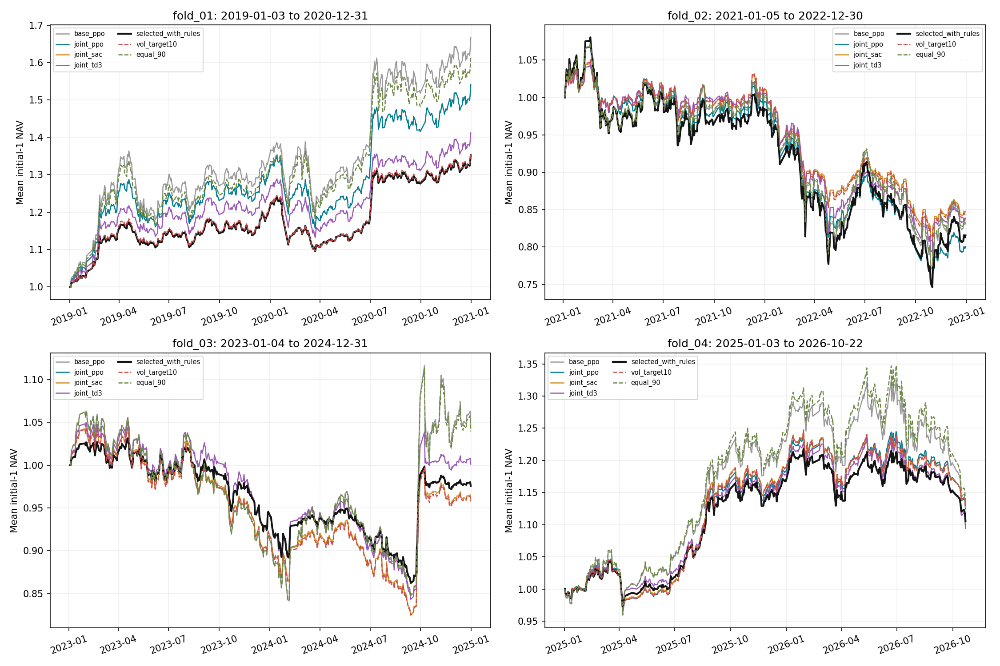
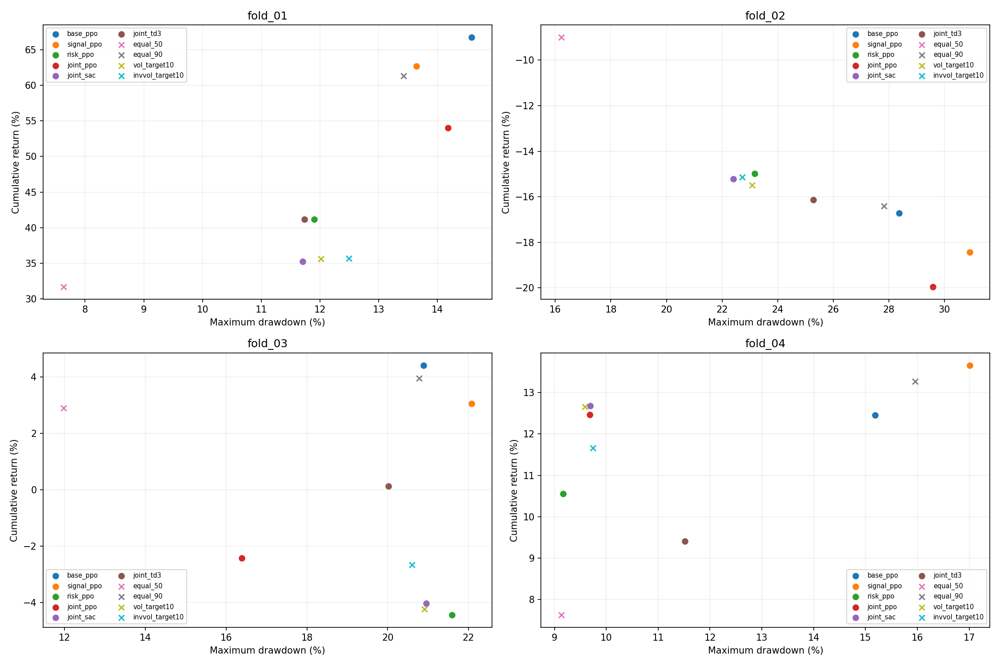

# v4 信息与风险配置研究

真实 A 股 ETF 历史回溯研究。历史测试区间已在 v3 看过，因此不是全新样本外证明。

六种 RL 候选、三个种子、四折独立测试；原始价格、分红应收/到账与拆分记账。
每折从 NAV=1 开始；不拼接历史。下表是各路径指标的均值±种子标准差；规则仅一条路径。
平衡分数=累计收益−0.5×最大回撤。它用于固定验证选择，不保证任何偏好的投资者都获益。
波动率和 Sharpe 按252天年化，无风险利率0；现金包含应收分红。目标波动不是实际风险保证。

[指标CSV](metrics.csv) · [成对超额区间](excess_intervals.csv) · [消融差异](ablation_metrics.csv) · [信号诊断](signal_metrics.csv)

## fold_01: 2019-01-03—2020-12-31

验证期 RL 选择：`joint_sac`；允许规则回退：`joint_sac`。

| 策略 | 累计收益 | 年化波动 | Sharpe | 最大回撤 | 平衡分数 | 日均换手 | 平均现金及应收 |
|---|---:|---:|---:|---:|---:|---:|---:|
| base_ppo | 66.73% ± 2.73% | 20.58% ± 1.09% | 1.39 ± 0.05 | 14.58% ± 0.70% | 59.44% ± 2.39% | 0.51% ± 0.11% | 3.28% ± 5.62% |
| signal_ppo | 62.65% ± 6.30% | 19.35% ± 1.89% | 1.40 ± 0.01 | 13.64% ± 1.23% | 55.83% ± 5.69% | 0.71% ± 0.21% | 9.04% ± 8.84% |
| risk_ppo | 41.20% ± 23.84% | 12.54% ± 6.22% | 1.43 ± 0.07 | 11.90% ± 5.50% | 35.25% ± 21.22% | 0.94% ± 0.41% | 41.28% ± 30.08% |
| joint_ppo | 54.02% ± 12.85% | 16.15% ± 3.77% | 1.47 ± 0.04 | 14.18% ± 2.19% | 46.93% ± 11.76% | 1.12% ± 0.09% | 23.37% ± 17.46% |
| joint_sac | 35.22% ± 0.80% | 11.54% ± 0.29% | 1.41 ± 0.05 | 11.71% ± 0.46% | 29.37% ± 0.90% | 0.99% ± 0.02% | 47.73% ± 0.87% |
| joint_td3 | 41.16% ± 23.60% | 13.32% ± 6.76% | 1.37 ± 0.06 | 11.73% ± 5.54% | 35.29% ± 20.97% | 2.46% ± 1.44% | 37.71% ± 32.15% |
| joint_mixture | 43.16% ± 9.27% | 13.46% ± 2.44% | 1.44 ± 0.01 | 12.47% ± 1.81% | 36.92% ± 8.43% | 1.36% ± 0.44% | 36.48% ± 11.17% |
| selected_on_validation | 35.22% ± 0.80% | 11.54% ± 0.29% | 1.41 ± 0.05 | 11.71% ± 0.46% | 29.37% ± 0.90% | 0.99% ± 0.02% | 47.73% ± 0.87% |
| selected_with_rules | 35.22% ± 0.80% | 11.54% ± 0.29% | 1.41 ± 0.05 | 11.71% ± 0.46% | 29.37% ± 0.90% | 0.99% ± 0.02% | 47.73% ± 0.87% |
| equal_50 | 31.70% | 10.72% | 1.39 | 7.63% | 27.89% | 0.24% | 49.90% |
| equal_90 | 61.30% | 19.29% | 1.38 | 13.42% | 54.59% | 0.31% | 9.98% |
| equal_100 | 69.26% | 21.43% | 1.38 | 14.83% | 61.85% | 0.34% | 0.02% |
| buy_hold | 68.03% | 21.21% | 1.38 | 14.60% | 60.73% | 0.21% | 1.01% |
| vol_target10 | 35.64% | 11.91% | 1.39 | 12.01% | 29.63% | 0.94% | 46.30% |
| invvol_target10 | 35.67% | 12.10% | 1.37 | 12.49% | 29.43% | 0.97% | 45.87% |

消融差异（前者减后者；回撤差值为负表示回撤降低）：

| 消融 | 收益差 | 回撤差 | 平衡分数差 |
|---|---:|---:|---:|
| signal_ppo-minus-base_ppo | -4.08% | -0.94% | -3.61% |
| risk_ppo-minus-base_ppo | -25.53% | -2.68% | -24.19% |
| joint_ppo-minus-risk_ppo | 12.82% | 2.28% | 11.68% |
| joint_ppo-minus-signal_ppo | -8.64% | 0.54% | -8.91% |

## fold_02: 2021-01-05—2022-12-30

验证期 RL 选择：`signal_ppo`；允许规则回退：`signal_ppo`。

| 策略 | 累计收益 | 年化波动 | Sharpe | 最大回撤 | 平衡分数 | 日均换手 | 平均现金及应收 |
|---|---:|---:|---:|---:|---:|---:|---:|
| base_ppo | -16.73% ± 1.56% | 16.31% ± 0.99% | -0.50 ± 0.02 | 28.37% ± 2.23% | -30.91% ± 2.67% | 0.60% ± 0.10% | 9.15% ± 4.62% |
| signal_ppo | -18.44% ± 1.13% | 16.86% ± 1.19% | -0.55 ± 0.01 | 30.91% ± 1.67% | -33.89% ± 1.96% | 0.69% ± 0.18% | 7.06% ± 6.75% |
| risk_ppo | -14.98% ± 3.49% | 11.41% ± 4.80% | -0.72 ± 0.14 | 23.17% ± 6.19% | -26.57% ± 6.58% | 0.85% ± 0.12% | 35.35% ± 27.51% |
| joint_ppo | -19.95% ± 3.98% | 13.39% ± 2.69% | -0.80 ± 0.05 | 29.59% ± 5.26% | -34.75% ± 6.60% | 1.26% ± 0.26% | 25.47% ± 15.96% |
| joint_sac | -15.22% ± 0.85% | 10.23% ± 0.39% | -0.79 ± 0.03 | 22.40% ± 0.98% | -26.42% ± 1.32% | 1.07% ± 0.08% | 40.56% ± 2.15% |
| joint_td3 | -16.14% ± 7.03% | 12.14% ± 2.05% | -0.69 ± 0.25 | 25.29% ± 7.28% | -28.78% ± 10.64% | 4.52% ± 1.19% | 41.05% ± 10.32% |
| joint_mixture | -16.99% ± 3.52% | 11.67% ± 1.53% | -0.77 ± 0.10 | 25.40% ± 4.34% | -29.69% ± 5.69% | 1.88% ± 0.24% | 35.59% ± 7.53% |
| selected_on_validation | -18.44% ± 1.13% | 16.86% ± 1.19% | -0.55 ± 0.01 | 30.91% ± 1.67% | -33.89% ± 1.96% | 0.69% ± 0.18% | 7.06% ± 6.75% |
| selected_with_rules | -18.44% ± 1.13% | 16.86% ± 1.19% | -0.55 ± 0.01 | 30.91% ± 1.67% | -33.89% ± 1.96% | 0.69% ± 0.18% | 7.06% ± 6.75% |
| equal_50 | -9.00% | 8.92% | -0.51 | 16.22% | -17.11% | 0.22% | 49.99% |
| equal_90 | -16.40% | 16.09% | -0.50 | 27.83% | -30.32% | 0.32% | 10.01% |
| equal_100 | -18.27% | 17.89% | -0.50 | 30.55% | -33.55% | 0.35% | 0.02% |
| buy_hold | -17.94% | 17.64% | -0.50 | 29.63% | -32.76% | 0.21% | 1.00% |
| vol_target10 | -15.50% | 10.69% | -0.77 | 23.08% | -27.04% | 1.02% | 38.11% |
| invvol_target10 | -15.15% | 10.75% | -0.74 | 22.73% | -26.51% | 1.08% | 37.17% |

消融差异（前者减后者；回撤差值为负表示回撤降低）：

| 消融 | 收益差 | 回撤差 | 平衡分数差 |
|---|---:|---:|---:|
| signal_ppo-minus-base_ppo | -1.71% | 2.53% | -2.98% |
| risk_ppo-minus-base_ppo | 1.74% | -5.20% | 4.34% |
| joint_ppo-minus-risk_ppo | -4.97% | 6.42% | -8.18% |
| joint_ppo-minus-signal_ppo | -1.51% | -1.32% | -0.85% |

## fold_03: 2023-01-04—2024-12-31

验证期 RL 选择：`joint_ppo`；允许规则回退：`joint_ppo`。

| 策略 | 累计收益 | 年化波动 | Sharpe | 最大回撤 | 平衡分数 | 日均换手 | 平均现金及应收 |
|---|---:|---:|---:|---:|---:|---:|---:|
| base_ppo | 4.41% ± 0.56% | 16.62% ± 0.87% | 0.22 ± 0.02 | 20.88% ± 1.23% | -6.03% ± 0.80% | 0.64% ± 0.14% | 9.07% ± 4.55% |
| signal_ppo | 3.05% ± 0.35% | 17.18% ± 1.55% | 0.18 ± 0.01 | 22.08% ± 2.11% | -7.99% ± 1.39% | 0.61% ± 0.14% | 8.26% ± 7.28% |
| risk_ppo | -4.43% ± 0.81% | 12.03% ± 1.72% | -0.14 ± 0.07 | 21.59% ± 1.98% | -15.23% ± 0.83% | 1.20% ± 0.13% | 27.23% ± 10.74% |
| joint_ppo | -2.43% ± 1.51% | 9.31% ± 2.28% | -0.09 ± 0.09 | 16.39% ± 3.99% | -10.62% ± 3.25% | 1.31% ± 0.31% | 44.70% ± 15.17% |
| joint_sac | -4.04% ± 0.65% | 11.67% ± 1.05% | -0.13 ± 0.01 | 20.95% ± 1.50% | -14.51% ± 1.38% | 1.20% ± 0.14% | 28.86% ± 6.08% |
| joint_td3 | 0.13% ± 2.49% | 12.12% ± 2.23% | 0.05 ± 0.11 | 20.02% ± 1.02% | -9.88% ± 2.55% | 3.97% ± 0.61% | 29.63% ± 11.01% |
| joint_mixture | -2.03% ± 0.51% | 10.90% ± 0.68% | -0.05 ± 0.03 | 19.00% ± 0.42% | -11.53% ± 0.55% | 1.84% ± 0.26% | 34.33% ± 4.36% |
| selected_on_validation | -2.43% ± 1.51% | 9.31% ± 2.28% | -0.09 ± 0.09 | 16.39% ± 3.99% | -10.62% ± 3.25% | 1.31% ± 0.31% | 44.70% ± 15.17% |
| selected_with_rules | -2.43% ± 1.51% | 9.31% ± 2.28% | -0.09 ± 0.09 | 16.39% ± 3.99% | -10.62% ± 3.25% | 1.31% ± 0.31% | 44.70% ± 15.17% |
| equal_50 | 2.90% | 9.23% | 0.21 | 11.97% | -3.09% | 0.22% | 49.99% |
| equal_90 | 3.95% | 16.43% | 0.20 | 20.77% | -6.44% | 0.30% | 10.02% |
| equal_100 | 4.03% | 18.21% | 0.20 | 22.87% | -7.41% | 0.33% | 0.03% |
| buy_hold | 3.52% | 17.83% | 0.19 | 22.68% | -7.82% | 0.21% | 1.33% |
| vol_target10 | -4.23% | 11.59% | -0.14 | 20.91% | -14.69% | 1.05% | 29.50% |
| invvol_target10 | -2.67% | 11.77% | -0.06 | 20.60% | -12.97% | 1.10% | 26.88% |

消融差异（前者减后者；回撤差值为负表示回撤降低）：

| 消融 | 收益差 | 回撤差 | 平衡分数差 |
|---|---:|---:|---:|
| signal_ppo-minus-base_ppo | -1.36% | 1.19% | -1.96% |
| risk_ppo-minus-base_ppo | -8.85% | 0.71% | -9.20% |
| joint_ppo-minus-risk_ppo | 2.01% | -5.20% | 4.61% |
| joint_ppo-minus-signal_ppo | -5.48% | -5.69% | -2.64% |

## fold_04: 2025-01-03—2026-10-22

验证期 RL 选择：`risk_ppo`；允许规则回退：`risk_ppo`。

| 策略 | 累计收益 | 年化波动 | Sharpe | 最大回撤 | 平衡分数 | 日均换手 | 平均现金及应收 |
|---|---:|---:|---:|---:|---:|---:|---:|
| base_ppo | 12.45% ± 1.91% | 15.04% ± 1.32% | 0.53 ± 0.04 | 15.19% ± 2.09% | 4.86% ± 0.87% | 0.50% ± 0.14% | 11.23% ± 8.48% |
| signal_ppo | 13.66% ± 0.56% | 15.93% ± 1.26% | 0.55 ± 0.02 | 17.01% ± 1.55% | 5.15% ± 0.76% | 0.71% ± 0.40% | 9.47% ± 8.16% |
| risk_ppo | 10.56% ± 3.04% | 10.04% ± 3.41% | 0.64 ± 0.02 | 9.17% ± 2.79% | 5.97% ± 1.66% | 1.12% ± 0.04% | 40.31% ± 16.10% |
| joint_ppo | 12.46% ± 2.14% | 10.71% ± 0.43% | 0.69 ± 0.09 | 9.68% ± 0.52% | 7.62% ± 2.25% | 1.32% ± 0.26% | 40.96% ± 2.33% |
| joint_sac | 12.68% ± 0.29% | 10.78% ± 0.42% | 0.70 ± 0.02 | 9.69% ± 0.56% | 7.84% ± 0.37% | 1.17% ± 0.04% | 38.70% ± 1.89% |
| joint_td3 | 9.41% ± 5.02% | 10.40% ± 6.03% | 0.56 ± 0.05 | 11.52% ± 5.87% | 3.65% ± 2.11% | 2.65% ± 0.34% | 42.18% ± 32.28% |
| joint_mixture | 11.69% ± 2.42% | 10.50% ± 1.99% | 0.66 ± 0.02 | 10.05% ± 1.83% | 6.66% ± 1.50% | 1.41% ± 0.06% | 40.56% ± 10.11% |
| selected_on_validation | 10.56% ± 3.04% | 10.04% ± 3.41% | 0.64 ± 0.02 | 9.17% ± 2.79% | 5.97% ± 1.66% | 1.12% ± 0.04% | 40.31% ± 16.10% |
| selected_with_rules | 10.56% ± 3.04% | 10.04% ± 3.41% | 0.64 ± 0.02 | 9.17% ± 2.79% | 5.97% ± 1.66% | 1.12% ± 0.04% | 40.31% ± 16.10% |
| equal_50 | 7.63% | 8.59% | 0.54 | 9.14% | 3.06% | 0.23% | 49.99% |
| equal_90 | 13.27% | 15.48% | 0.55 | 15.95% | 5.29% | 0.34% | 10.04% |
| equal_100 | 14.60% | 17.21% | 0.55 | 17.59% | 5.80% | 0.38% | 0.06% |
| buy_hold | 14.61% | 17.16% | 0.55 | 17.81% | 5.71% | 0.23% | 1.82% |
| vol_target10 | 12.66% | 10.73% | 0.70 | 9.58% | 7.86% | 1.01% | 38.47% |
| invvol_target10 | 11.66% | 10.73% | 0.65 | 9.74% | 6.79% | 1.09% | 35.92% |

消融差异（前者减后者；回撤差值为负表示回撤降低）：

| 消融 | 收益差 | 回撤差 | 平衡分数差 |
|---|---:|---:|---:|
| signal_ppo-minus-base_ppo | 1.21% | 1.82% | 0.30% |
| risk_ppo-minus-base_ppo | -1.89% | -6.02% | 1.12% |
| joint_ppo-minus-risk_ppo | 1.90% | 0.51% | 1.65% |
| joint_ppo-minus-signal_ppo | -1.20% | -7.33% | 2.47% |

## 成本与统计

已完成成本评估：5 bps, 10 bps, 20 bps。完整指标见 CSV。更高成本使用同一模型重新执行，持仓反馈可能变化。
成对区间按对齐市场日，种子先平均，每折独立10日移动分块 bootstrap 2000 次。估计252×日均算术超额，并非CAGR区间。没有多重比较校正，也没有消除历史反复开发的偏差。

信息读出诊断固定 Ridge alpha=10，仅在训练期拟合缩放/系数，随后验证/测试不调整。未来5日标签完全在各自分区内。它不参与策略选择，也不代表RL实际使用了哪些信号。

风险层与信息特征需结合消融、低仓位等权和无RL动态风险规则评估；收益减少与回撤减少必须同时展示。三只相关性高的长期存续宽基ETF不能代表全A股。研究使用分数份额，不验证券商成交或实时运行。

